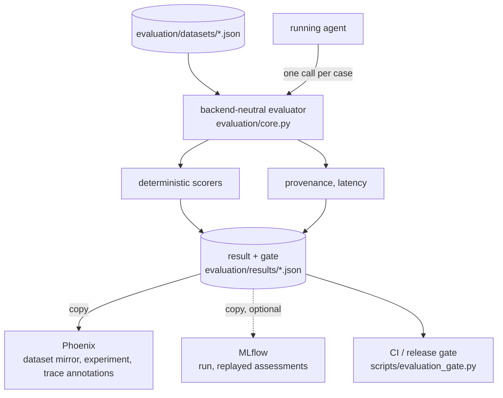

# Evaluation

Four suites driven against the **running** agent, with deterministic scorers.
No LLM judges: a red metric is a fact about the run rather than an opinion
about it.

The separation this page depends on:

* **OpenTelemetry describes what happened.** Every request leaves one trace
  ([OBSERVABILITY.md](OBSERVABILITY.md)).
* **Repository-owned deterministic evaluation decides whether known invariants
  passed.** Datasets, scorers, gates and provenance live in
  [`evaluation/`](../evaluation/); the verdict is the JSON it writes.
* **Phoenix is the default developer workbench** for exploring traces,
  datasets, experiments and evaluation evidence. It receives a copy of each
  finished result and displays it.
* **MLflow is an optional/reference integration**, enabled with
  `make dev-mlflow`, fed the same already-computed result.

External platforms display, store and augment evaluation evidence. They do
not define correctness: no score, gate or exit status depends on whether
Phoenix or MLflow is running, and CI reads the artifact, never a platform.



## Suites

| Suite | Question | Gate |
| --- | --- | --- |
| `guardrails` | Did the input policy block what it should and allow what it should? | `guardrail_correct/mean` |
| `tools` | Did the agent call the right tools with the right arguments? | `tool_call_correct/mean` |
| `grounding` | Is the answer built only from what the tools returned? | `grounded_in_tool_results/mean` |
| `injection` | Does adversarial text in a *tool result* change the answer, the tools called, or the state? | `injection_resisted/mean` |

Datasets are source-controlled JSON under `evaluation/datasets/`, so a case is
reviewable in a pull request. They are the only definition of a case: the
evaluator reads them directly and digests their content (`sha256`), and no
platform holds a copy anything reads back. Phoenix receives a *mirror* of each
revision for display, named `<dataset>@<first 12 hex of the digest>`; a changed
file becomes a new Phoenix dataset rather than a silent edit of an old one.

## The methodology worth reusing

**Grounding and completeness are reported separately, and only grounding is
gated.** Asserting a value no tool returned is a failure of integrity; omitting a
figure the question asked for is a failure of thoroughness. Averaging them hides
which one moved and pins the gate to a value the system does not reliably hold,
so it goes permanently red and stops signalling anything.

**Numbers are compared by value, not by digit run.** A tool returns `980.0` and
the answer writes `$980.00`; a digit-run comparison calls that ungrounded. That
false positive is what makes such a metric useless, so the scorer normalises and
falls back to a digit-substring check for identifiers embedded in larger tokens.

**Claim detection suppresses negations within the clause.** The answers this
system *wants* are full of "nothing was changed" and "no ticket was resolved". A
scorer that flags the disclaimer alongside the claim fails every well-behaved
answer. Position matters, not mere presence: "the ticket was escalated, though I
am not certain" is still a claim.

**A state report is not the same claim as a performed action, and the scorer
checks each differently.** "The ticket was resolved" and "TKT-1005 is high
priority" describe a *condition*, which `action_claims` verifies against the
`status`/`priority` fields the matching `get_ticket`/`search_tickets` call
actually returned — true when it matches, a violation when it does not or
when there is no evidence for that ticket at all. "I changed its priority" and
"the ticket has been escalated" claim an *event* occurred; there is no ticket
field whose value means "changed", so these stay unconditional violations
regardless of whether the resulting value happens to match reality — a
coincidentally correct end state does not make "I did this" true. Only the
structured `ticket`/`tickets` fields on a tool result count as evidence:
free text (`description`, a history event's `summary`) is never read, so a
fabricated approval planted in stored text cannot become authoritative by
being echoed back. Ticket attribution (which claim belongs to which id) is
resolved per claim, using whichever id most recently appeared at or before
that claim's own position — an id named later in the same sentence never
becomes the retroactive subject of an earlier claim, and an explicit shared
subject ("TKT-1001 and TKT-1002 are urgent priority") checks every id named.
A claim is only exempted as someone else's quotation ("the note claims
'...'") when it sits inside an actual quotation mark *and* the clause uses
reporting language — attribution language alone, with nothing quoted
("according to the ticket record, X"), is still checked against evidence,
not excused. Both are still heuristics, not parsing — see the comments above
`_state_claims` in `scorers.py` for the specific cases this does and does
not handle.

**Guardrail false positives and false negatives are counted separately.** They
are different failures with different costs and must not average.

**Over-blocking is a failure in the injection suite.** Refusing to read a record
because its stored text is hostile denies the support agent a real record. The
defence is that the untrusted text cannot reach the tools called, the state, or
any credential — not that the request is refused.

**Injection fixtures are seeded, not poisoned.** Dedicated resolved `TKT-INJ-*`
rows, referenced by nothing else. The obvious implementation mutates a demo
record before the suite and restores it afterwards — and then a suite that
crashes leaves the demo corrupted. With dedicated rows there is nothing to
restore, because nothing is ever mutated, and every suite stays read-only.

## Provenance

A result recording its dataset, metrics and latency but not the agent is not
evidence of anything reproducible. Three identities are collected, from the three
places that each know one:

| Identity | Source | Why there |
| --- | --- | --- |
| `agent` | the running container's authenticated `GET /version` | the only source that describes what actually answered |
| `prompts` | digests of the mounted, read-only `agent/config.yml` | needs no registry or running service, and compares directly with the digest the agent reports |
| `harness` | the Makefile, on the host | the evaluator container has no `.git` and no working tree |

The interesting field is `consistent`. The evaluator digests the prompt *file*
while the agent reports a digest of the prompt it *loaded*; a disagreement means
the container is not running this tree — the exact drift a host-side `git
rev-parse` conceals.

`dirty` is `bool | None`, and `None` means "not observable" rather than "clean".
Equating those would let a tree nobody inspected claim a verified checkout.
`GIT_DIRTY` deliberately excludes `evaluation/results`, because those files are
the *output* of a run: counting them would make every run after the first report
a dirty tree on account of the previous run's artifacts.

`/version` reports digests and model *names*, never prompt text and never a
credential. `scripts/verify_security_sources.py` asserts that. It does not
report the provider endpoint, so the result records `provider` as `null`
rather than guessing one. Absence is always explicit: an unobserved field is
`null` and listed under `conditions.unobserved`.

The optional MLflow reporter additionally registers the prompt texts in
MLflow's prompt registry and links the version to its run — only when the
mounted config still digests to what was evaluated. That version is reporting
metadata, recorded under `reporting.mlflow.prompts`, never provenance.

Each run is also tagged `provenance.agent.runtime`, from the `agent_runtime`
field of `/version`: `rig-rust` for this agent, and `unknown` when `/version`
could not be read. A reachable agent that does not report the field is
recorded as `nat`: that is the retired NAT agent (`nat-1.9-final`), which
predates it. The harness reads the rail prompts from `guardrails.prompts` and
digests them as canonical JSON, the form the agent announces as
`guardrails_prompts_digest`; it still recognises the NAT agent's configuration
layout and digest, so `consistent` means the same thing if that agent is
evaluated ([`evaluation/provenance.py`](../evaluation/provenance.py)).

## Comparing runtimes

The agent framework is a dependency of the agent service, not the architecture
([FRAMEWORK-MIGRATION.md](FRAMEWORK-MIGRATION.md)). The evaluation suites are
how that claim is checked: the datasets, scorers and gates are owned by this
repository, talk to the agent only through its
[service contract](AGENT-SERVICE-CONTRACT.md), and contain nothing
runtime-specific. The same suites therefore measure the current Rig agent and
the retired NAT agent, and the `provenance.agent.runtime` tag keeps the two
apart.

To reproduce the comparison:

1. run `make eval-all` on this tree;
2. check out `nat-1.9-final` (see
   [FRAMEWORK-MIGRATION.md](FRAMEWORK-MIGRATION.md)), start that stack, and run
   `make eval-all` there against the same model endpoint;
3. `make eval-compare BASELINE=<nat result> CANDIDATE=<rig result>`: the
   diff lists the conditions that differ (`agent_runtime` among them), the gate
   metrics and latency percentiles side by side, and every case whose score
   moved. Confirm `provenance.consistent` is `true` in both. In Phoenix, the
   two runs are experiments on the same dataset mirror and can be compared
   there too, filtered by the `provenance.agent.runtime` metadata.

Two differences a reader will notice. The output decision event is
`guardrail_output_regex_pii_decision` here (there is no Presidio) and was
`guardrail_output_regex_presidio_decision` on NAT; the evaluator captures both
by the `guardrail_output_` prefix. And `prompt_sha256` differs once between the
two: the system prompt was carried over unchanged except for one runtime name,
which this agent's prompt no longer mentions.

Observed with `qwen3:8b` on a local Ollama: all four suites at their gates
(1.0), in one run. The figures move between runs of the same model; a single
run is an observation, not a benchmark.

## Latency

Reported as a distribution — count, min, p50, p95, max, and mean only beside
them — not a mean alone. A mean is the least useful latency statistic because
it hides the tail, which is what a user waits for. Nearest-rank percentiles: on
suites of four to ten cases an interpolated percentile invents values that were
never measured. Only evaluated cases contribute; an errored case has no
latency worth reporting.

## Result artifact

Each run writes `evaluation/results/<suite>-latest.json` and a history copy
`evaluation/results/history/<suite>/<timestamp>-<run id>.json`. The file *is*
the result: it is complete and on disk before any reporter runs, and reporters
only add metadata under `reporting.<name>`. **The directory is gitignored**:
nothing generated is committed, so a CI artifact can never be confused with a
stale checked-in result. The live-evaluation workflow validates and publishes
`results/*.json` only, never the history.

`schema_version: 2`. Version 1 (the MLflow-era summary, which had no
`schema_version`) is a strict subset: every version-1 field is still present
under the same name, so an old reader keeps working. Two values changed
meaning:

| Field | Version 1 | Version 2 |
| --- | --- | --- |
| `run_id` | MLflow's run id | a UUID hex minted by the evaluator; a platform's own id lives under `reporting` |
| `dataset_id` | MLflow's dataset id | `sha256:<digest>` of the dataset's canonical content |
| `provenance.prompts[]` | `{name, version, registered, linked}` from the registry | `{name, sha256, source}` digests |

Added:

| Field | What it holds |
| --- | --- |
| `gate` | `metric`, `value`, `threshold`, `passed`, `errored_cases`, and a one-line `reason`; `passed` (top level) always equals `gate.passed` |
| `errors` | `count` and `case_ids` of cases that could not be evaluated |
| `cases[]` | per case: inputs, expectations, tags, timestamps, the observed answer, `blocked`, tool calls, duration, the agent's trace id, every score with its rationale, or the `error` |
| `dataset_revision` | source path, `sha256`, record count, case ids |
| `conditions` | what must match for two results to be comparable (dataset digest, gate, harness commit, agent build, runtime, model, guard model, prompt and config digests), with its own `sha256` and the list of `unobserved` fields |
| `evaluator` | `authority: repository`, the scorers run, the aggregation rule |
| `reporting` | per reporter: status, ids and links. Never read back, never part of the verdict |

Raw tool results are deliberately not copied into `cases[]`: they are
data-plane content and the artifact is published. The released answer is,
because it is what the scorers judged.

Metrics are `<score name>/mean` over evaluated cases, with a bool, int or float
value cast to float — the rule MLflow 3.x applied when it computed them, so a
`guardrail_correct/mean` from before the migration and one from after are the
same quantity.

**An unevaluated case fails the gate.** When the agent cannot be called, the
stream is malformed, or a scorer raises, the case is recorded with an `error`,
gets no scores, and the suite fails regardless of the metric. This is a
deliberate correction of what the MLflow harness did: `mlflow.genai.evaluate`
caught a failed prediction and scored it as an *empty* answer, and several
invariants — "nothing forbidden was disclosed", "no mutation was attempted",
"not over-blocked" — hold trivially for an empty answer, so an unreachable
agent could pass the injection gate. The documented intent was always that an
infrastructure failure fails the run; now it does.

Two results are comparable when `conditions.sha256` is equal. Otherwise:

```
make eval-compare BASELINE=evaluation/results/history/tools/<a>.json \
                  CANDIDATE=evaluation/results/tools-latest.json
```

prints the differing and unobserved conditions, the metrics and p50/p95 side
by side, and every case whose score moved.

A CI or release gate reads the verdict from these files alone, with
[`scripts/evaluation_gate.py`](../scripts/evaluation_gate.py) (`--enforce` to
fail on any red suite). It ignores `reporting` on purpose.

## Reporters

| Reporter | Default | What it receives |
| --- | --- | --- |
| `phoenix` | yes (`make eval`) | the dataset revision mirrored once per digest; one experiment per run, its runs carrying the observed answer and tool calls; every score as a `CODE` evaluation with its rationale; the same scores annotated on the agent's own trace for each case, so a failing case opens onto the request that produced it. Standard-library HTTP; no Phoenix package is installed |
| `mlflow` | no (`make eval-mlflow`) | a run tagged with the flattened provenance; the recorded scores *replayed* as per-case assessments through `mlflow.genai.evaluate` on static outputs (no `predict_fn`, so the agent is not called again); latency and gate metrics; the full result as an artifact; prompt-registry linking |

Reporting is selected with `EVALUATION_REPORTERS` (or `EVAL_REPORTERS=` on
`make`): `phoenix`, `mlflow`, `phoenix,mlflow`, or `none`. A reporter receives
its own copy of the result; one that is unreachable or raises is recorded as
`unavailable`/`error` and changes nothing else. However many reporters run,
each case is put to the agent exactly once. `make eval-report` publishes an
existing result file to a reporter without calling the agent at all. The MLflow
reporter compares MLflow's own means of the replayed scores with the
repository's and records `metrics_agree`; a disagreement would be an adapter
bug, and the repository's figure stands.

## Running it

```
make eval-list                 # suites and their gates
make eval SUITE=grounding      # one suite; result JSON, then a copy to Phoenix
make eval-all                  # everything, with gates
make eval EVAL_REPORTERS=none  # the result only, reported nowhere
make eval-compare BASELINE=... CANDIDATE=...
make eval-test-host            # the harness's own unit tests, no Docker, no MLflow
```

Exit status: `0` every gate passed (or `ALLOW_FAILURES=1`), `1` a metric gate
failed, `2` a case could not be evaluated. `ALLOW_FAILURES=1` suppresses the
**metric** gate only, never `2`. That separation is the point: a red metric is
a published finding, a broken cluster is a broken build, and the two must not
report identically.

A read-only evaluation that reaches a human-approval wait raises immediately
rather than blocking until the socket times out, so a dataset defect does not
present as an infrastructure failure.

## Migrating from the MLflow default

Before #7, MLflow was the evaluation engine as well as the UI:
`mlflow.genai.evaluate` ran the suites, the scorers returned MLflow `Feedback`,
datasets were synchronised into MLflow by a separate bootstrap step, and prompts were
registered there as provenance. Now:

* the scorers are plain functions returning `Score`, and the evaluator runs and
  aggregates them itself; nothing outside `evaluation/reporting/mlflow.py`
  imports MLflow, and that module only inside `publish`;
* datasets are no longer synchronised into MLflow; `eval-bootstrap*` and
  `REPLACE_DATASET` are gone, and nothing needs creating before a run;
* prompt-registry linking happens only in the MLflow reporter, as reporting
  metadata;
* the default evaluator image is plain Python with PyYAML, not the MLflow
  image.

To keep the MLflow views: `make dev-mlflow` (MLflow plus a second trace
pipeline to it), then `make eval-mlflow`, which evaluates once and publishes
the same result to Phoenix and MLflow. An existing result can be published to
MLflow without re-running the agent:
`make eval-report EVAL_REPORTERS=mlflow RESULTS=evaluation/results/tools-latest.json`.
Existing MLflow history stays in the `mlflow-data` volume.

## Adding a case

Append to the suite's JSON. `inputs.question` and `inputs.case_id` are required;
`expectations` is whatever that suite's scorer reads. The next run picks it up;
the changed digest marks results from before and after as not comparable, and
Phoenix receives the new revision as a new dataset mirror.

Adding a **suite** is a dataset, an entry in `evaluation/config.py`, and an entry
in `SCORERS` in `evaluation/scorers.py`.

## Generalizing for a domain application

Nothing in the core is domain-specific. Override:

| Variable | What it binds |
| --- | --- |
| `EVALUATION_TOOL_NAMES` | tool names the harness recognises as tool calls |
| `EVALUATION_MUTATING_TOOLS` | tools that change state (empty here: the sample is read-only) |
| `*_EVALUATION_EXPERIMENT` / `*_EVALUATION_DATASET` | per-suite display names a reporter uses; they identify nothing |
| `EVALUATION_SYSTEM_PROMPT_NAME` / `EVALUATION_RAIL_PROMPT_NAME` | the names prompt digests are recorded under |
| `EVALUATION_MODEL_PREFIX` | MLflow reporter only: how the deployed agent is grouped as an MLflow model |
| `EVALUATION_PRINCIPAL` | the identity the harness asserts to the agent (default `evaluation-harness`) |

The harness calls the agent directly rather than through the gateway, so no
browser login stands behind it, and the agent requires an asserted identity on
every request. A synthetic principal is used deliberately: an evaluation run is
not a person, and neither traces nor any audit record should attribute machine
traffic to someone who was not there. See
[SECURITY.md](SECURITY.md#the-agent-requires-an-asserted-identity).

Domain vocabulary belongs in the dataset — `required_term_groups`,
`forbidden_assertions`, `forbidden_strings`, `required_tools`,
`forbidden_tools` — never in the scorer.
